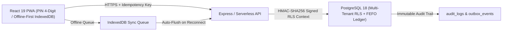

# Beitro Dripper — Senior System Analyst & AI-Augmented Product Builder

> **11+ Years in Banking Technology** (BCA Digital, Bank Mandiri, Standard Chartered) | Payment Protocols (`ISO 8583`, `BASE24`, `EMV`), Lending Systems & Regulatory Compliance (`OJK/BI`) | **AI-Augmented Systems Architecture & Workflow Automation**

- **Live Product Demo:** [gastro-cashier.vercel.app](https://gastro-cashier.vercel.app/)
- **LinkedIn:** [linkedin.com/in/beitro-dripper-37255192](https://www.linkedin.com/in/beitro-dripper-37255192)
- **Email:** beitrodripper@gmail.com

---

## Featured Case Study: Gastro Cashier (Multi-Tenant Cloud POS, KDS & FEFO Inventory)

**Problem Statement:**  
Growing F&B outlets often lose margin during peak hours due to unstable Wi-Fi dropping POS orders, misplaced paper kitchen tickets, manual stock shrinkage, and weak multi-outlet data isolation.

**Solution Architecture (Closed-Source Commercial Product — Public Case Study):**  
Designed and shipped an end-to-end multi-tenant cloud POS, Kitchen Display System (KDS), and FEFO inventory ledger platform using **TypeScript, React 19, Vite PWA, Node.js/Express, and Serverless PostgreSQL (Neon)**.

### Key Architectural Highlights
- **Database-Enforced Multi-Tenant Isolation (Signed RLS):** Every API transaction signs the tenant/outlet context using HMAC-SHA256 (`txid` + `jti` + TTL) and executes under a least-privilege non-owner PostgreSQL role (`NOSUPERUSER`, `NOBYPASSRLS`).
- **Offline-First Resilience:** Browser IndexedDB caches menu/table snapshots and queues `ORDER` and `SETTLE` mutations when Wi-Fi drops, automatically flushing in-order with idempotency keys once connectivity returns.
- **FEFO Inventory & Recipe Depletion:** Atomic stock ledger (`SELECT ... FOR UPDATE`) supporting First-Expired-First-Out (FEFO) lot consumption, weighted average cost, recipe BOM auto-deduction, and owner-approved stock takes.
- **Automated Verification:** Verified with E2E API/inventory transaction suites, 100-customer concurrent load simulations, and static release exposure audits.

👉 **Deep Dive:** See [docs/architecture-case-study.md](./docs/architecture-case-study.md) and educational SQL pattern [examples/signed-rls-pattern.sql](./examples/signed-rls-pattern.sql).

### UI Snapshots
| PIN & Role Login | Floor Plan & POS | Kitchen Display (KDS) |
| :---: | :---: | :---: |
|  |  |  |

---

## Banking & Enterprise Highlights (11+ Years)
- **BCA Digital (2022–Present):** Designed the Corporate Lending Portal with synchronous REST credit-bureau APIs (**-30% loan processing time**); added early pipeline monitoring checkpoints (**-35% errors in Q1**); led incident RCA & OJK compliance reviews.
- **Bank Mandiri (2018–2022):** Delivered **I-SAKU cardless withdrawal** on Mandiri Online (**1.5M users in 6 months**); led end-to-end **EMV chip migration** (**-60% fraud in year one**); integrated ATM Merah Putih with Jalin (Himbara) network.
- **Standard Chartered (2014–2018):** Supported daily ATM/digital banking channels, 6-digit PIN rollout, and website revamp UX/flow documentation.

---

## Non-Commercial AI & Automation Stack
- **Multi-Agent SDLC Orchestration:** Role-based agent pipeline (Strategy, Architecture, Engineering, QA, GTM) routing tasks across Gemini and Claude models for faster FSD/TSD drafting, code review, and test verification.
- **Workflow & Operations Automation:** Scheduled `n8n` pipelines, webhook integrations, and Python-based operational assistants.
- **Programmatic Media & Docs:** Automated product tour video rendering (Remotion/TypeScript) and structured `.docx`/`.pdf` documentation generators.
