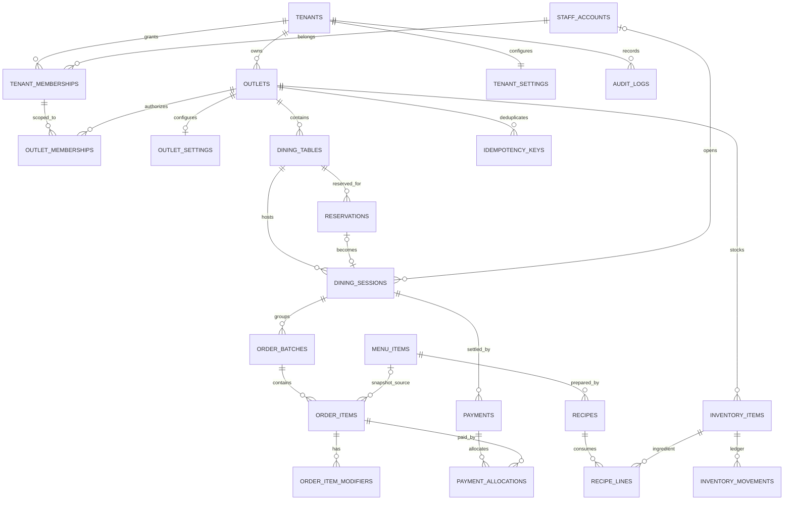

# Architecture Case Study: Multi-Tenant POS, Offline-First Sync & FEFO Inventory

This document summarizes the non-commercial system analysis, relational data modeling, and architectural decisions behind **Gastro Cashier** (`https://gastro-cashier.vercel.app/`). Production source code, credentials, and tenant data remain private.

---

## 1. Relational Data Model & Domain Boundaries (PostgreSQL)

Operational data is tenant-scoped; outlet-owned records carry both `tenant_id` and `outlet_id` and enforce composite foreign keys to prevent cross-outlet references.

### Domain Catalogue
| Domain | Core Entities | Purpose |
| :--- | :--- | :--- |
| **Tenant & Access** | `tenants`, `outlets`, `staff_accounts`, `tenant_memberships`, `outlet_memberships` | Identity, tenant selection, outlet authorization, account status |
| **Configuration** | `tenant_settings`, `outlet_settings` | Tax/service rates and payment-flow defaults |
| **Floor & Reservation** | `dining_tables`, `reservations`, `dining_sessions` | Table state, reservation gate, one active session per table |
| **Menu** | `menu_categories`, `menu_items`, `modifier_groups`, `modifier_options` | Tenant/outlet-aware menu catalogue and modifiers |
| **Ordering** | `order_batches`, `order_items`, `order_item_modifiers` | Shared session workspace and monotonic order batches |
| **Payment** | `payments`, `payment_allocations` | Cash/QRIS/card settlement, partial and payment-first allocation |
| **Inventory** | `inventory_items`, `recipes`, `recipe_lines`, `inventory_movements` | FEFO stock ledger and recipe BOM consumption |
| **Reliability & Audit** | `audit_logs`, `outbox_events`, `idempotency_keys` | Append-only audit, offline sync outbox, retry-safe commands |

### Key Data Integrity Rules
1. **Tenant/Outlet Boundary:** Composite foreign keys require related rows to share the same `tenant_id` and `outlet_id`.
2. **One Open Session per Table:** Partial unique index (`uq_one_open_session_per_table`) prevents concurrent cashiers from opening duplicate active sessions on one table.
3. **Optimistic Concurrency:** `dining_sessions.version` is checked and incremented inside the same SQL transaction.
4. **Monotonic Order Batches:** Unique `(tenant_id, outlet_id, session_id, batch_number)` allocated while locking the session row with `SELECT ... FOR UPDATE`.
5. **Payment Idempotency & Allocations:** Unique `idempotency_key` per outlet guarantees retries return the original result; `payment_allocations` prevents over-allocation.
6. **Audit Immutability:** Trigger rejects `UPDATE` and `DELETE` on `audit_logs`, and the runtime role holds `INSERT`/`SELECT` only.

---

## 2. Security Boundary: Signed PostgreSQL Row-Level Security (RLS)
- The API runs under a dedicated unprivileged role (`NOSUPERUSER`, `NOBYPASSRLS`).
- Before executing tenant-scoped queries, the API signs a transaction-scoped context payload (`tenant_id`, `outlet_id`, `txid_current()`, `jti`, `exp`) with HMAC-SHA256.
- PostgreSQL RLS policies verify the signature inside a `SECURITY DEFINER` function before returning or mutating rows.
- **Graceful Fallback (ADR-001):** Rate-limiting tables (`auth_rate_limits`) wrap context checks with safe fallbacks so PIN authentication remains resilient even if a secondary environment context is locked.

---

## 3. Offline-First Resilience (ADR-003)
1. **Local Cache:** Browser `IndexedDB` stores active menu, table layout, and session snapshots.
2. **Sync Queue:** When `navigator.onLine` is false or `fetch` fails on network drop, `ORDER` and `SETTLE` mutations enqueue locally with unique **idempotency keys**.
3. **Auto-Flush:** `online` event listeners + a 30-second fallback interval flush queued actions sequentially upon reconnect and refresh the live POS snapshot.

---

## 4. Atomic FEFO Inventory Ledger
- Locks target inventory items in deterministic order (`SELECT ... FOR UPDATE`) inside a SQL transaction.
- Consumes ingredient lots using **First-Expired-First-Out (FEFO)** ordering (`expiry_date ASC NULLS LAST, received_at ASC`).
- Records immutable ledger entries (`balance_after`, `weighted_average_cost`) and lot consumption links so order cancellations atomically restore exact stock balances.

---

## 5. Production RCA & Verification Highlights
- **Concurrency & E2E Suites:** Automated scripts verify stock = 1 race conditions (`201` vs `409`), idempotency replay, and cancel-restock flows.
- **Load Simulation:** 100-customer concurrent simulation covering dual cashiers, KDS kitchen routing, and stock depletion.
- **Release Exposure Audit:** Static artifact verification on `dist/` ensuring zero leaked source maps or credential markers.
- **Resilient Bot/LLM Ops (RCA Lessons):** Replaced blocking external TTS subprocesses with strict boundary timeouts + local fallbacks and configured multi-model LLM fallbacks for operational bots.
